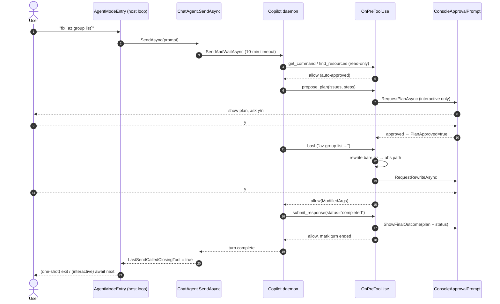
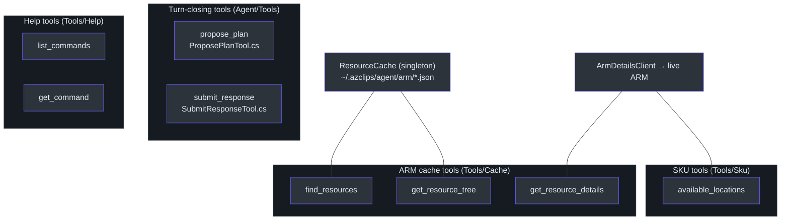

# AI Agent

## Overview — why an agent, and what it actually is

When a normal `az`/`Az` command fails, Azclips can fall back to an **AI agent** that reads the
failed command, figures out what went wrong, proposes a concrete fix, and — with the user's
approval — runs it. The agent lives in the `Agent/` project (`Core.Agent.csproj`,
assembly `azclips-agent`).

> ### ⚠️ Fact vs. stale documentation
> `eng-docs/spec/ARCHITECTURE.md` describes the agent as *"Azure OpenAI Integration — CloudAgent
> with GPT-4o-mini"* driven by an `AgentEngine`/`OrchestratorEngine`
> (`eng-docs/spec/ARCHITECTURE.md:9`, `:20`). **That document is stale.** The shipping agent is
> built on the **GitHub Copilot SDK** (`GitHub.Copilot.SDK` `1.0.13`,
> `Agent/Core.Agent.csproj:31`) which drives a **bundled Copilot CLI daemon** resolved from
> the SDK's NuGet payload (`Agent/BundledDaemonResolver.cs:11`). There is no `CloudAgent`,
> `AgentEngine`, or hard-wired `gpt-4o-mini`. The model is configurable; the `builtin`
> provider's internal default is `gpt-5.4-mini` (`src/Core/Core.Abstractions/Config/AgentOptions.cs:110`). Treat
> the code as ground truth and `ARCHITECTURE.md` as out of date for the agent.

The rest of this page traces the real implementation: the daemon transport, the `ChatAgent`
turn contract, the tool surface, prompt selection, and the console host that renders it.

---

## The bundled daemon transport

The Copilot SDK is a *client*; the actual model orchestration runs in a separate **daemon
process** that ships inside the SDK NuGet package. `BundledDaemonResolver.Resolve()` locates
that executable under the RID-specific native folder
(`Agent/BundledDaemonResolver.cs:13`):

```csharp
var binaryName = OperatingSystem.IsWindows() ? "copilot.exe" : "copilot";
var rid  = GetPortableRid() ?? Path.GetFileName(RuntimeInformation.RuntimeIdentifier);
var path = Path.Combine(AppContext.BaseDirectory, "runtimes", rid, "native", binaryName);
return File.Exists(path) ? path : null;
```

`GetPortableRid()` maps the OS/arch to `win|linux|osx`-`x64|arm64`, so on Apple Silicon the
path becomes `runtimes/osx-arm64/native/copilot`. `ChatAgent` then opens a stdio RPC
connection to it (`Agent/ChatAgent.cs:113`):

```csharp
var client = new CopilotClient(new CopilotClientOptions
{
    Logger = sdkLogger,
    Connection = RuntimeConnection.ForStdio(path: BundledDaemonResolver.Resolve()),
});
```



```mermaid
flowchart LR
    CLI["az group list (fails)<br>src/CLI/Program.cs"] -->|spawn azclips-agent --agent-mode| Entry["AgentModeEntry<br>Agent/AgentMode"]
    Entry -->|CreateAsync| CA["ChatAgent<br>Agent/ChatAgent.cs"]
    CA -->|CopilotClient| SDK["GitHub.Copilot SDK"]
    SDK -->|stdio RPC| Daemon["Bundled Copilot CLI daemon<br>runtimes/&lt;rid&gt;/native/copilot"]
    Daemon -->|provider config| Model["Model backend<br>builtin: Azure-APIM gpt-5.4-mini<br>github: user's Copilot sub"]

    style CLI fill:#2d333b,stroke:#6d5dfc,color:#e6edf3
    style Entry fill:#2d333b,stroke:#6d5dfc,color:#e6edf3
    style CA fill:#2d333b,stroke:#6d5dfc,color:#e6edf3
    style SDK fill:#2d333b,stroke:#6d5dfc,color:#e6edf3
    style Daemon fill:#2d333b,stroke:#6d5dfc,color:#e6edf3
    style Model fill:#2d333b,stroke:#6d5dfc,color:#e6edf3
```

The daemon owns model calls and the built-in tools (bash, view, edit, grep, glob, web_fetch,
web_search, todo). Azclips supplies the *system prompt*, a set of **custom tools**, and a set
of **hooks** that gate and rewrite every tool call.

For the `builtin` provider, `ChatAgent` also sets `CopilotClientOptions.RequestHandler` to
`EncryptedReasoningRequestHandler` (`Agent/Providers/EncryptedReasoningRequestHandler.cs`).
The daemon still builds each model request, but azclips sends it with .NET `HttpClient`, so
proxy and certificate settings follow .NET and the OS. Builtin requests use `store: false`,
and the daemon replays encrypted reasoning items in the next request. The endpoint's load
balancer picks a region for each request, and another region rejects those items with
`400 invalid_encrypted_content`. So the handler removes the reasoning items before each
request is sent, together with the `id` of the other input items (`item_reference` items keep
theirs; `call_id` does not change). It does not retry: each response goes back to the daemon
unchanged. The `github` provider does not use this handler.

### Provider selection

`agent.provider` (config) chooses the backend (`Agent/ChatAgent.cs:242`):

| Provider  | Resolved model              | Auth                                                    |
| --------- | --------------------------- | ------------------------------------------------------ |
| `builtin` (default) | Internal `BuiltinProviderOptions.ModelId` (default `gpt-5.4-mini`) | Azure token acquired via MSAL, pointed at the APIM endpoint chosen by `BuiltinEndpointResolver` with the `responses` wire API |
| `github`  | daemon default              | The user's own GitHub Copilot subscription             |

`agent.provider` and `agent.reasoningEffort` are supported customer settings. The
`agent.builtin` section is excluded from the customer-facing schema with
`IncludeInSchema = false`: its model ID and API version remain internal provider wiring,
not advertised `az config` keys. The options still feed `BuiltinProviderConfig.Build`
(`src/Core/Core.Abstractions/Config/AgentOptions.cs:14`,
`Agent/Providers/BuiltinProviderConfig.cs:68`).

For `builtin`, `AgentStartupBoundary` acquires one Azure access token silently and uses it
for the tenant data-boundary lookup (`Agent/AgentMode/AgentStartupBoundary.cs`).
`BuiltinEndpointResolver.Choose` then picks the gateway (`Agent/Providers/BuiltinEndpointResolver.cs`).
By default, the boundary picks the gateway: a confirmed `Global` boundary selects the production East US gateway; `EU`, an
unknown boundary, a failed lookup, and a managed-identity profile (no tenant) select production West
Europe. `BuiltinProviderConfig.Build` reuses the same token and builds a `ProviderConfig {
Type = "azure", WireApi = "responses", BaseUrl = <resolved url>, BearerToken = ... }`
(`Agent/Providers/BuiltinProviderConfig.cs`). The agent
trace's `session_start` event records `endpointHost`, `endpointSource`, and `dataBoundary`.
If no Azure login exists, the agent fails with a message telling the user to `az login` or
switch to the `github` provider (`BuiltinProviderConfig.BuildAuthErrorMessage`). Any other
provider value is rejected.

---

## Entering agent mode from the CLI fallback

The agent never runs in the failing `az` process. When a command fails and the agent is
enabled, `src/CLI/Program.cs` launches the standalone `azclips-agent` process through
`AgentProcessRunner`, carrying a `RecoveryRequest` and telemetry context
(`src/CLI/Program.cs:554`, `Agent/Program.cs:9`):

```csharp
psi.Environment["AZCLIPS_IN_AGENT_MODE"] = "1";   // recursion guard
psi.ArgumentList.Add("--agent-mode");
psi.ArgumentList.Add("--failed-command");
psi.ArgumentList.Add(JoinShellQuoted(args));
```

`AZCLIPS_IN_AGENT_MODE=1` prevents recursive launches. Redirected streams block automatic
**interactive** recovery, not one-shot recovery. Automatic one-shot suggestions preserve the
original failure exit code (`src/CLI/Recovery/AutomaticRecoveryPolicy.cs:11`,
`src/CLI/Program.cs:639`).

`Agent/AgentMode/AgentModeEntry.cs` then reads `AgentOptions`, picks the prompt flavor, builds
the renderer/approval/spinner stack, and calls `ChatAgent.CreateAsync(...)`
(`Agent/AgentMode/AgentModeEntry.cs:90`). The first user turn is synthesized from the failure:
*"I tried `<cmd>` but it failed: `<error>`. Help me fix it."* (`AgentModeEntry.cs:110`).

---

## `ChatAgent` — the turn contract

`ChatAgent` (`Agent/ChatAgent.cs:24`) is the single-agent entry point. Hosts create one, then
drive a loop they own with `SendAsync`, racing the send `Task` against the approval pump.

### Act-through-tools with turn-closing tools

The central rule: **every turn must end by calling a turn-closing tool**. Replying in bare
prose — even after querying with `get_command` or `bash` — is a protocol violation. Two tools
can close a turn, tracked via `_sendCalledClosingTool` (`Agent/ChatAgent.cs:40`) and exposed
as `LastSendCalledClosingTool` (`ChatAgent.cs:49`):

- **`submit_response`** — the *sole session terminator* (`IsSessionTerminator`,
  `ChatAgent.cs:625`). Reports `completed | rejected | failed`.
- **`propose_plan`** — a *mid-turn artifact* that renders a plan for approval. In
  **interactive** mode it counts as closing (it stops for y/n); in **one-shot** mode it does
  **not** close — the agent must go on to `submit_response` so the plan is actually rendered
  (`IsClosingTool`, `ChatAgent.cs:618`).

Diagnostic/help tools (`get_command`, `find_*`, `list_*`) never satisfy the contract. After a
send, the host inspects `LastSendCalledClosingTool`; a bare-prose turn is forced to correct.

### Turn timeout and one-shot vs interactive

`SendAsync` links the host token to a per-turn CTS and calls `SendAndWaitAsync` with a
**10-minute** turn timeout (`TurnTimeout`, `ChatAgent.cs:26`; `SendAsync`, `ChatAgent.cs:352`):

```csharp
private static readonly TimeSpan TurnTimeout = TimeSpan.FromMinutes(10);
...
await _session.SendAndWaitAsync(
    new MessageOptions { Prompt = prompt },
    timeout: TurnTimeout,
    cancellationToken: turnCts.Token);
```

`SessionState.IsOneShot` is `!options.IsInteractive` (`ChatAgent.cs:186`). It changes when the
session ends: `SessionClosed` is true only when one-shot **and** `submit_response` has rendered
(`ChatAgent.cs:70`). One-shot exits on the first `submit_response`; interactive keeps the
conversation open (the user can answer the plan's questions) until they type exit/quit.

### The `OnPreToolUse` gate

Every tool call passes through `HandlePreToolUseAsync` (`Agent/ChatAgent.cs:384`) — the heart
of the safety model. In order, it:

1. **Post-terminator gate.** If `submit_response` already ran this turn, deny any further tool
   call (rather than cancelling, which would masquerade as Ctrl+C) (`ChatAgent.cs:395`).
2. **`submit_response`.** Validates args; on failure denies with a self-correction hint; on
   success renders the final outcome (plan + status) and marks the turn ended (`ChatAgent.cs:407`).
3. **`propose_plan`.** Validates and captures issues/steps/placeholders/defaults into
   `SessionState`. One-shot allows silently; interactive asks y/n and, on **reject**, rolls
   back the approval gate and tells the model to re-plan (`ChatAgent.cs:454`).
4. **Plan-before-execute gate.** `bash`/`powershell` are denied until a plan is approved
   (`state.PlanApproved`) (`ChatAgent.cs:516`).
5. **Placeholder guard.** A command still containing `<placeholder>`/<code v-pre>{{...}}</code>/`YOUR_*` is
   denied so the agent asks the user for the real value (`PlaceholderDetector`,
   `ChatAgent.cs:539`).
6. **`az` rewrite.** A bare `az` in a shell command is rewritten to the absolute exe path that
   launched the agent, then re-approved and passed through as `ModifiedArgs` (`ChatAgent.cs:548`).

`OnPermissionRequest` complements this: read-only cache tools (`find_`/`get_`/`list_` prefix)
are auto-approved; everything else routes to the user prompt (`ChatAgent.cs:271`, `:975`).

### Turn lifecycle sequence



---

## Tools

Azclips registers its custom tools alongside the daemon's built-ins via `SessionConfig.Tools`
(`Agent/ChatAgent.cs:247`). `AvailableTools = null` means "all built-ins plus these".



| Tool                    | Source                                          | Role                                                                    |
| ----------------------- | ----------------------------------------------- | ----------------------------------------------------------------------- |
| `propose_plan`          | `Agent/Hosting/ProposePlanTool.cs:21`             | Structured fix (issues / steps / placeholders / defaults); host renders it |
| `submit_response`       | `Agent/Hosting/SubmitResponseTool.cs:20`          | Terminal outcome: `completed` / `rejected` (`OUT_OF_SCOPE_*`) / `failed` |
| `list_commands` / `get_command` | `Agent/Tools/Help/HelpTools.cs`       | Read a validated local catalog; `get_command` still takes one `name`   |
| `find_resources` / `get_resource_tree` / `get_resource_details` | `Agent/Tools/Resource/Cache/CachedResourceTools.cs:15` | Query the local ARM cache; `get_resource_details` can fetch live ARM props |
| `available_locations`   | `Agent/Tools/Resource/Sku/AvailableLocationsTool.cs:26`  | Given a VM SKU, list regions where it's available (SkuNotAvailable recovery) |

The `propose_plan` schema is deliberately **structured**, not free-form markdown, so the host
renders each part as its own styled block; argument validation lives in the hook, so the tool
body only logs (`ProposePlanTool.cs:44`). `submit_response`'s status enum and message rules are
likewise validated in the hook so the model gets a correction prompt instead of a stack trace
(`SubmitResponseTool.cs:40`).

### Direct-read help catalog

Help lookups should not start another CLI process on every tool call.
`HelpTools`, `az agent tool docs list`, and `az agent tool docs show --name <name>` therefore share
`HelpCatalogProvider.ListJsonAsync` / `GetJsonAsync`. The public result remains the
baseline camelCase `HelpIndex`, single `HelpCommand`, or `not_found` object with
suggestions; the catalog header is never returned to the model. `get_command`
still accepts one string `name`, including case-insensitive PowerShell names
(`Agent/Tools/Help/HelpCatalogProvider.cs:53`, `Agent/Tools/Help/HelpLookup.cs:22`).

| Catalog state | Behavior |
| --- | --- |
| Fresh | Validate the on-disk inputs and read JSON in process; no `az` subprocess. |
| Missing, stale, or corrupt | Attempt regeneration once, then require a valid, matching artifact. Concurrent calls on the same provider share regeneration. |
| Expected generation/read failure | Return an explicit `help_catalog_*` error; never substitute an empty catalog or reuse stale help. A later call can retry. Unexpected defects propagate to the host's error handling. |

The default is **on-demand generation**, not a prewarmed installation.
`az agent tool docs generate` uses the current `IAssemblyLoadingService` discovery
and `ExtensionHelpManifestBuilder`, preserving installed-version selection and
registry pins. Failed extension loads abort generation rather than publishing
partial help as complete. CLI help regenerates in process; the standalone agent
invokes that generation command only when needed
(`Agent/Commands/Processors/DocsGenerateProcessor.cs:30`,
`Agent/Commands/Processors/DocsProcessorBase.cs:16`).

`IAssemblyLoadingService.LoadAllExtensions` documents `null` as no discovered
extensions, so that result legitimately produces an empty catalog. A discovery
exception does not produce or stamp a catalog
(`src/Core/Core.Abstractions/IAssemblyLoadingService.cs`,
`src/Core/Core.AssemblyLoading/AssemblyLoadingService.cs`).

Generated envelopes live in `~/.azclips/agent/help/`
(`HomePaths.GetDefaultAgentHelpDirectory()`). Tests set `AZCLIPS_HOME` to isolate
runs; the catalog then lives under `$AZCLIPS_HOME/agent/help/`. Readers also
recognize matching envelopes beside the CLI, in its packaged Agent extension directory, and in the development
`Core.Agent` output. Existing unwrapped help-export artifacts remain unchanged
and are not treated as a fresh cache
(`Agent/Tools/Help/HelpCatalogProvider.cs`, `ArtifactDirectories`;
`src/CLI/Help/HelpArtifactWriter.cs`, `WriteArtifacts`).

`HelpCatalogFingerprint.Read` fingerprints the shared bundled roots, configured
`assemblyLoading.installedExtensionsRoot` / prefix, version directories, DLL and
NuGet file sizes/write times, registry contents, CLI version, and authored help
files. This is conservative invalidation, **not a duplicate of the loader's
SemVer/pin selection**. Adds, removals, version changes, rebuilds, configuration
path changes, and pin changes invalidate the next read. Generation verifies the
stamp again before publishing; publishers share a cancellable, cross-process file
lock, and each artifact is replaced atomically
(`Agent/Tools/Help/HelpCatalogFingerprint.cs:21`,
`src/CLI/AssemblyLoading/ExtensionDiscoveryPaths.cs`,
`src/CLI/Help/HelpArtifactWriter.cs`, `WriteCatalog` / `AcquireCatalogLock`).

### ARM resource cache tools

`CachedResourceTools` reads a **process-wide singleton** `ResourceCache`
(`Agent/Tools/Resource/Cache/ResourceCache.cs:22`) backed by JSON files under `~/.azclips/agent/arm/`.
The cache is *built and refreshed by another component* — these tools only **read**, and
degrade to empty results if a file is missing (`ResourceCache.cs:7`). Indexes are built lazily
and rebuilt when a file's mtime changes.

`get_resource_details` can escalate to **live** ARM via `ArmDetailsClient`
(`Agent/Tools/Resource/Cache/ArmDetailsClient.cs:14`), which uses `Azure.ResourceManager` with a
2-minute process-local cache. Authentication is bridged through
`AuthServiceTokenCredential` (`Agent/Tools/Resource/Cache/AuthServiceTokenCredential.cs:13`), an adapter
that exposes the internal `IAuthService`/MSAL pipeline as an Azure SDK `TokenCredential` — so
ARM SDK calls reuse the single ClientId, shared cache, and shared telemetry rather than a
separate credential chain.

---

## Prompts

The system prompt is chosen by **interaction mode** and loaded from a `.md` file copied next to
the binary (`LoadSystemPrompt`, `Agent/ChatAgent.cs:982`). <code v-pre>{{flavor}}</code> (e.g. `azure cli`) is
substituted at load time:

| Entrypoint | File                     | When                                        |
| ---------- | ------------------------ | ------------------------------------------- |
| `oneshot`  | `Agent/prompts/oneshot.md` | `SessionStyle` is not interactive (default) |
| `inline`   | `Agent/prompts/inline.md`  | `SessionStyle = interactive`                |

Effective recovery settings select `inline` or `oneshot`. These are the only valid entrypoints;
invalid values throw rather than guessing which prompt to load
(`Agent/ChatAgent.cs:601`). The prompts encode the act-through-tools contract and the
scope rules (harmful/unrelated → `rejected`), e.g. `Agent/prompts/oneshot.md`.

---

## Hosting & rendering

The console host stack lives in `Agent/Hosting/`. Its overriding concern is that **stdin has
exactly one reader** — the SDK's permission callback runs on a daemon background thread, so
naive `Console.ReadLine()` there would race the host loop.

| Component               | Source                                       | Responsibility                                                                 |
| ----------------------- | -------------------------------------------- | ------------------------------------------------------------------------------ |
| `ConsoleAgentRenderer`  | `Agent/Hosting/ConsoleAgentRenderer.cs:4`    | Renders events/text; **quiet** mode in one-shot; drops trailing prose after `submit_response` |
| `ConsoleApprovalPrompt` | `Agent/Hosting/ConsoleApprovalPrompt.cs:27`  | Decouples SDK callback (producer) from host thread (consumer) via a `Channel` + `TaskCompletionSource`; only the pump thread touches stdin |
| `AbortKeyWatcher`       | `Agent/Hosting/AbortKeyWatcher.cs:5`         | During a busy turn, polls `Console.KeyAvailable`: Esc aborts the turn, Ctrl+C quits; no-op on redirected stdin |
| `SpinnerService`        | `Agent/Hosting/SpinnerService.cs:8`          | Braille spinner whose verb updates on tool-start events                        |
| `TraceAgentRenderer`    | `Agent/Hosting/TraceAgentRenderer.cs:16`     | Decorator that writes a best-effort JSONL trace when `agent.trace.enabled`, under `agent.trace.path` |

The producer/consumer split is the key pattern: the SDK's `OnPermissionRequest` posts a request
onto an unbounded channel and awaits a `TaskCompletionSource`; the host pumps it with
`PumpOneAsync` on its own thread (`ConsoleApprovalPrompt.cs:7`). The host loop races the send
against the pump so approvals resolve while a turn is in flight
(`SendAndPumpAsync`, `Agent/AgentMode/AgentModeEntry.cs:258`):

```csharp
var completed = await Task.WhenAny(sendTask, pumpTask, watcherTask);
```

`TraceAgentRenderer` always forwards to the inner renderer first, then writes the trace under
try/catch so a slow disk can't break output; prose suppression after the terminator is
always-on in `ConsoleAgentRenderer`, independent of tracing (`TraceAgentRenderer.cs:6`).

---

## Environment probes & hooks

Before the model's first turn (and on each user prompt), `EnvSnapshotProvider.GetJsonAsync`
builds a live `EnvironmentSnapshot` **in process**, without running `az agent tool env show`
or reading a separate snapshot file. The CLI env command uses the same provider
(`Agent/Tools/Env/EnvSnapshotProvider.cs:14`, `Agent/Commands/Processors/EnvProcessor.cs`).
The JSON is injected by `SessionHooks.OnSessionStart` / `OnUserPromptSubmitted`
(`Agent/ChatAgent.cs`, `BuildBaseSessionConfig`). The prober reports OS, shell, cwd, SSH
session, browser availability, stdin interactivity, and **whether the user is signed in** — the
latter by reading the **active profile** from `IProfileService`
(`Agent/Tools/Env/EnvironmentProber.cs`, `ProbeAsync`). This is the direct link to the
[Configuration & Profile Management](./configuration-profiles.md) subsystem: the agent knows
the signed-in subscription because it reads the same active profile the engine resolves.

Each hook reads the supplied profile service again, so switching profiles or signing
out is visible on the next turn. The reported version belongs to the target CLI,
not the standalone agent executable, and the flavor remains `cli`. Read errors are
explicit `environment_snapshot_failed` objects rather than fabricated signed-out
snapshots; cancellation and unexpected programming faults propagate. Only expected
file/access/JSON failures (including the existing profile-read wrapper) are converted
to error objects. Existing context formatting suppresses error
objects, while successful snapshots retain the CLI-boundary reminder, failed-command
help, and signed-out login-help prefetch
(`Agent/Tools/Env/EnvSnapshotProvider.cs:14`, `Agent/Common/EnvSnapshotFormatter.cs`,
`Agent/ChatAgent.cs`, `BuildBaseSessionConfig`).

`PlaceholderDetector` (`Agent/Hooks/PlaceholderDetector.cs:6`) is the single hook module — a
set of regexes (`<name>`, <code v-pre>{{...}}</code>, `YOUR_*`, `*-PLACEHOLDER`) used by the pre-tool gate to
block commands that still contain unfilled placeholders, forcing the agent to ask the user
rather than run a broken command.

---

## Note on `Program.cs`

`Agent/Program.cs` is the real standalone recovery entry point. It dispatches `--agent-mode`
to `AgentModeEntry.RunAsync`; that process owns the chat loop. The Hex1b shell under `TUI/`
is separate and does not host this entry point
(`Agent/Program.cs:9`, `Agent/AgentMode/AgentModeEntry.cs:46`, `TUI/Program.cs:22`).

---

## References

- `Agent/Core.Agent.csproj` — `GitHub.Copilot.SDK` 1.0.13, `net10.0`, prompt content copy
- `Agent/BundledDaemonResolver.cs` — RID → `runtimes/<rid>/native/copilot`
- `Agent/ChatAgent.cs` — daemon client, turn contract, `OnPreToolUse` gate, provider selection, prompt loading
- `Agent/Hosting/ProposePlanTool.cs`, `SubmitResponseTool.cs` — turn-closing tools
- `Agent/Tools/Help/HelpTools.cs`, `HelpCatalogProvider.cs`, `HelpCatalogFingerprint.cs` — direct-read help tools
- `Agent/Tools/Resource/Cache/ResourceCache.cs`, `CachedResourceTools.cs`, `ArmDetailsClient.cs`, `AuthServiceTokenCredential.cs` — ARM cache + live details
- `Agent/Tools/Resource/Sku/AvailableLocationsTool.cs` — SKU/location recovery
- `Agent/Hosting/ConsoleApprovalPrompt.cs`, `ConsoleAgentRenderer.cs`, `AbortKeyWatcher.cs`, `SpinnerService.cs`, `TraceAgentRenderer.cs`
- `Agent/Tools/Env/EnvSnapshotProvider.cs`, `EnvironmentProber.cs`, `Agent/Hooks/PlaceholderDetector.cs`
- `Agent/prompts/oneshot.md`, `Agent/prompts/inline.md`
- `Agent/AgentMode/AgentModeEntry.cs`, `src/CLI/Program.cs` — CLI fallback → agent-mode entry
- `src/Core/Core.Abstractions/Config/AgentOptions.cs:10` — recovery trigger/style/history, provider selection, and schema-hidden builtin options
- `eng-docs/spec/agent-experience.md` — agent UX spec; `eng-docs/spec/ARCHITECTURE.md` — **stale** re: the agent
